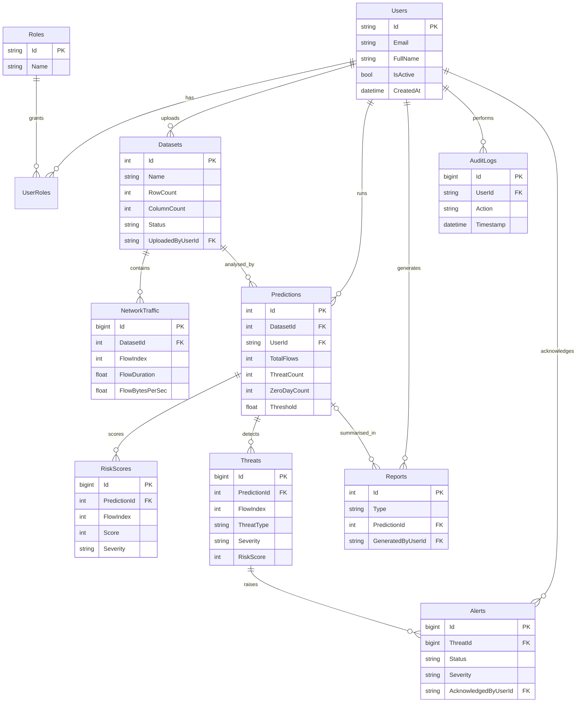

# Entity-Relationship Diagram

Render with any Mermaid viewer (GitHub, VS Code "Markdown Preview Mermaid Support", https://mermaid.live).

Design notes
- `NetworkTraffic` is linked logically to `Threats`/`RiskScores` through (Prediction.DatasetId, FlowIndex); no direct FK, which avoids SQL Server multiple-cascade-path errors.
- Delete cascade: Dataset -> NetworkTraffic, Predictions -> (RiskScores, Threats -> Alerts). Reports survive prediction deletion (`SET NULL`). Audit logs survive user deletion (`SET NULL`).
